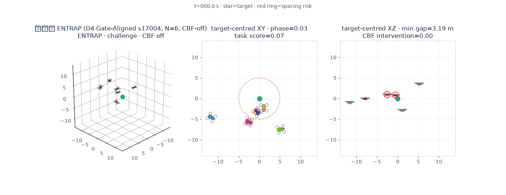
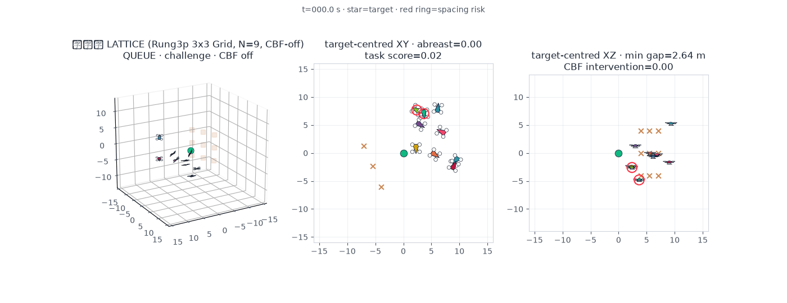
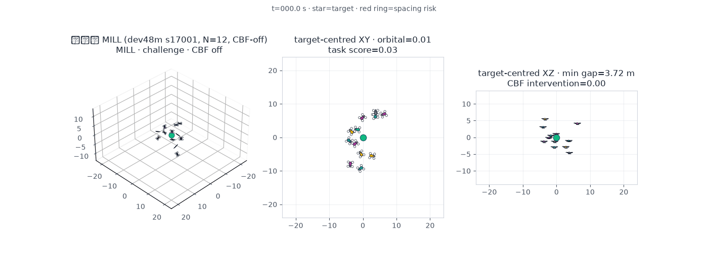
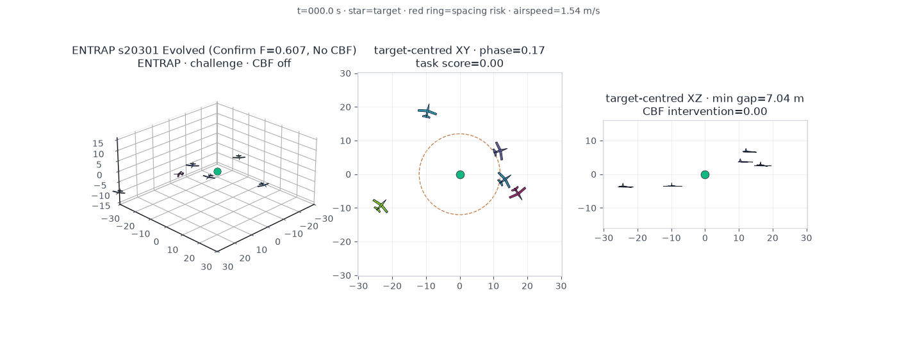
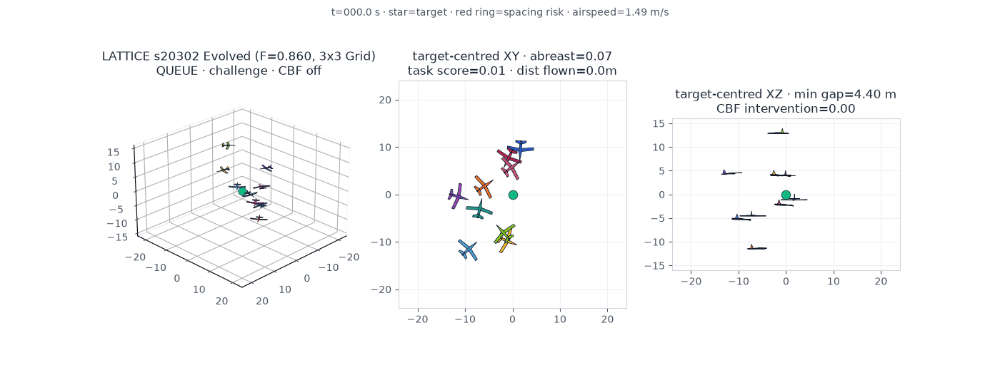
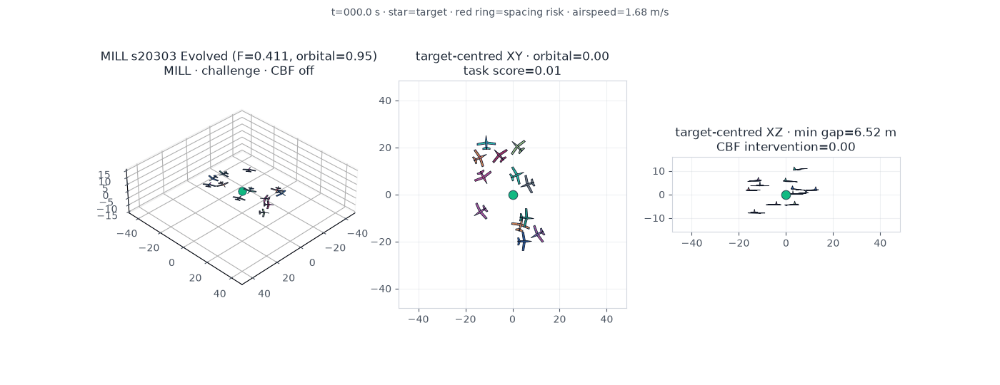
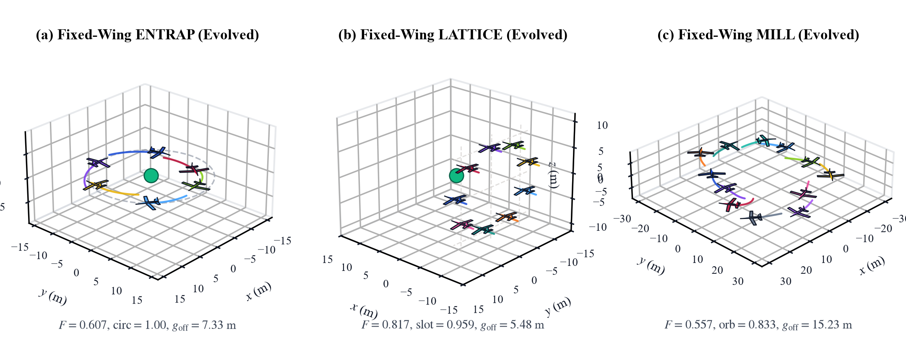

# ACES: Autonomous Controller Evolution for Interpretable Swarm Coordination in Decentralized Aerial Systems

[](LICENSE)
[]()
[-blueviolet.svg)]()
[]()
[]()
[-success.svg)]()

Official project repository and animated closed-loop trajectory showcase for the manuscript:

> **ACES: Autonomous Controller Evolution for Interpretable Swarm Coordination in Decentralized Aerial Systems**  
> *Submitted to Information Sciences (Elsevier)*  
> *Author: Chen Wang (王琛) `<wangchen20@nudt.edu.cn>`*

---

## 🌟 Research Overview & Core Contributions

1. **Constructively Valid 3D Gene Growth Tree (3D-GGT) Representation & Shield-Off Evaluation**:  
   Formulates decentralized aerial swarm controllers as strongly typed **3D Gene Growth Trees (3D-GGTs)** featuring a fixed tri-branch vector-aggregation root, disjoint scalar ($\mathcal{S}$) and 3D vector ($\mathcal{V}$) node classes, a spherical vector constructor, hard parsimony caps ($D \le 4, L \le 32$), and a closed 24-operator gene-editing action space. Architectural decoupling of the symbolic policy, continuous flight dynamics, and supervisory Control Barrier Function (CBF) projection ensures that every morphology and pairwise clearance claim is settled **strictly shield-off (CBF disabled)**.
2. **Gate-Aligned Quality–Diversity & Multi-Fidelity Horizon Alignment**:  
   Couples Median Absolute Deviation (MAD) $\varepsilon$-lexicase specialist selection with a complementary $7 \times 7 \times 7$ behavioral repertoire (retaining both task-morphology and unshielded constraint-progress elites per cell) and aligns archive promotion and final champion selection with the full operational horizon ($T = 2500$ steps), eliminating short-horizon evaluation deception.
3. **Dual-Dynamics Multi-Task Synthesis & Analytical Mechanism Discovery**:  
   Synthesizes compact, closed-form velocity laws across three canonical 3D aerial coordination tasks—**ENTRAP** (moving-target encirclement), **LATTICE** ($3 \times 3$ vertical barrier formation), and **MILL** (unanchored self-centered 3D milling)—evaluated across both **13-state rigid-body quadrotors** and **nonholonomic 3D Dubins fixed-wing aircraft** (with a literature-grounded aerodynamic module and GVF template library).

---

## 🎬 Animated Closed-Loop Trajectory Gallery (Shield-Off, CBF Disabled)

All animations below display **unshielded (CBF-off) closed-loop flight rollouts** driven solely by the evolved 3D-GGT symbolic velocity controllers.

### Part I: 13-State Rigid-Body Quadrotor Swarm (`quadrotor`)

| (a) **Quadrotor ENTRAP ($N=6$)**<br>*Moving-Target Encirclement* | (b) **Quadrotor LATTICE ($N=9$)**<br>*$3\times 3$ Transverse Barrier Grid* | (c) **Quadrotor MILL ($N=12$)**<br>*Unanchored 3D Rotational Mill* |
| :---: | :---: | :---: |
| <br><code>quadrotor_entrap.gif</code> | <br><code>quadrotor_lattice.gif</code> | <br><code>quadrotor_mill.gif</code> |
| **Champion (`s17004` / `s17005`)**:<br>`~%&cAA&FBd^&zEf&aAH`<br>($F_{\mathrm{off}} = 0.934$, $g_{\mathrm{off}} = 5.23\,\mathrm{m}$) | **3D Cartesian Periodic Potential**:<br>Orthogonal cross-track & vertical standing-wave wells<br>($F_{\mathrm{off}} = 0.906$, $\mathrm{plane} = 1.000$) | **Champion (`s17004`)**:<br>`~?&eBI%0&hDM0`<br>($F_{\mathrm{off}} = 0.332$, $\mathrm{orb} = 0.580$, `mill_wo_filter=True`) |

---

### Part II: Nonholonomic 3D Dubins Fixed-Wing Swarm (`fixed_wing`, $v_{\mathrm{stall}}=0.80\,\mathrm{m/s}, R_{\min}=4.0\,\mathrm{m}$)

| (a) **Fixed-Wing ENTRAP ($N=6$)**<br>*Co-Rotating Loiter Capture* | (b) **Fixed-Wing LATTICE ($N=9$)**<br>*Line-Abreast $3\times 3$ Cruise Grid* | (c) **Fixed-Wing MILL ($N=12$)**<br>*Emergent Unanchored Milling* |
| :---: | :---: | :---: |
| <br><code>fixed_wing_entrap.gif</code> | <br><code>fixed_wing_lattice.gif</code> | <br><code>fixed_wing_mill.gif</code> |
| **Champion (`s20301`)**:<br>$12\,\mathrm{m}$ loiter ring, $60^{\circ}$ phase lock<br>($F_{\mathrm{off}} = 0.607$, $\mathrm{circ} = 1.000$, $g_{\mathrm{off}} = 7.33\,\mathrm{m}$) | **Champion (`s20302`)**:<br>$1.60\,\mathrm{m/s}$ cruise, $3\times 3$ standing-wave slots<br>($F_{\mathrm{off}} = 0.817$, $\mathrm{slot} = 0.959$, $g_{\mathrm{off}} = 5.48\,\mathrm{m}$) | **Champion (`s20303`)**:<br>`~&wuI?¶$$&°EI&2EM``<br>($F_{\mathrm{off}} = 0.557$, $\mathrm{orb} = 0.833$, $g_{\mathrm{off}} = 15.23\,\mathrm{m}$) |

<p align="center">
  
</p>

---

## 📊 Key Benchmark Comparisons

### 1. Confirmatory 16-Seed Quadrotor Encirclement Panel ($T = 2500$, Shield-Off)

| Method / Paradigm | Trials ($n$) | Complete Successes | Success Rate | Wilson 95% CI | Median Fitness $F_{\mathrm{off}}$ | Peak Fitness |
| :--- | :---: | :---: | :---: | :---: | :---: | :---: |
| **ACES (3D-GGT, Gate-Aligned)** | 16 | **5 / 16** | **31.3%** | `[0.142, 0.556]` | **0.244** | **0.957** |
| Standard Typed GP | 16 | 2 / 16 | 12.5% | `[0.035, 0.360]` | 0.096 | 0.916 |
| Uniform Archive Drift | 16 | 1 / 16 | 6.3% | `[0.011, 0.283]` | 0.243 | 0.892 |
| Standard MAP-Elites | 16 | 0 / 16 | 0.0% | `[0.000, 0.194]` | 0.092 | 0.261 |
| Typed Random Search | 16 | 0 / 16 | 0.0% | `[0.000, 0.194]` | 0.095 | 0.686 |
| MAPPO (Centralized Critic MARL) | 5 | 0 / 5 | 0.0% | `[0.000, 0.434]` | 0.000 | 0.011 |
| IPPO (Decentralized MARL) | 5 | 0 / 5 | 0.0% | `[0.000, 0.434]` | 0.001 | 0.019 |

### 2. Nonholonomic Fixed-Wing Multi-Task Synthesis vs. 6 Baselines ($T = 2500$, Shield-Off)

| Task | MAPPO | IPPO | Typed Random | Archive Drift | MAP-Elites | Typed GP | **ACES (Ours)** |
| :--- | :---: | :---: | :---: | :---: | :---: | :---: | :---: |
| **MILL ($N=12$)** | 0.0831 | 0.1244 | 0.2696 | 0.2350 | 0.2483 | 0.2024 | **0.3670** *(nominal 0.4806)* |
| **ENTRAP ($N=6$)** | 0.0024 | 0.0014 | 0.0130 | 0.0061 | 0.1025 | 0.0288 | **0.6025** |
| **LATTICE ($N=9$)** | 0.0116 | 0.0130 | 0.0190 | 0.0464 | 0.0258 | 0.0527 | **0.7944** |

---

## 📂 Repository Layout

```text
ACES/
├── animations/                 # Shield-off closed-loop rollout GIFs (Quadrotor & Fixed-Wing)
│   ├── quadrotor_entrap.gif
│   ├── quadrotor_lattice.gif
│   ├── quadrotor_mill.gif
│   ├── fixed_wing_entrap.gif
│   ├── fixed_wing_lattice.gif
│   └── fixed_wing_mill.gif
├── figures/                    # High-resolution trajectory figures
├── LICENSE                     # MIT License
└── README.md                   # Project overview and visual benchmark gallery
```

---

## 📜 Citation

```bibtex
@article{wang2026aces,
  author  = {Wang, Chen},
  title   = {{ACES}: Autonomous controller evolution for interpretable swarm coordination in decentralized aerial systems},
  journal = {Information Sciences},
  year    = {2026},
  note    = {Submitted}
}
```

### Related Foundational Works by Our Group
- **NGSE (GGT Foundation)**: C. Wang, C. Zhu, M. Lu, J. Bai, and L. Qiao, "Neural-guided symbolic evolution: From symbolic control search to mechanism discovery in swarm robotics," *Engineering Applications of Artificial Intelligence*, vol. 181, p. 115720, 2026. `doi:10.1016/j.engappai.2026.115720`
- **DANCE**: C. Wang, C. Zhu, X. Zhu, H. Lei, W. Zhang, and M. Wu, "DANCE: Distributed co-evolutionary design of velocity controllers for swarm intelligence robots in flocking and entrapping tasks," *Swarm and Evolutionary Computation*, vol. 94, p. 101854, 2025. `doi:10.1016/j.swevo.2025.101854`
- **GRN Entrapment**: C. Wang, Z. Shi, M. Gu, W. Luo, X. Zhu, and Z. Fan, "Revolutionary entrapment model of uniformly distributed swarm robots in morphogenetic formation," *Defence Technology*, vol. 31, pp. 496–509, 2024. `doi:10.1016/j.dt.2022.08.015`
- **AGENT**: C. Wang, W. Kuang, M. Gu, and Z. Fan, "AGENT: An adaptive grouping and entrapping method for flocking systems," *Journal of Computational Design and Engineering*, vol. 10, no. 1, pp. 357–367, 2023. `doi:10.1093/jcde/qwac136`
